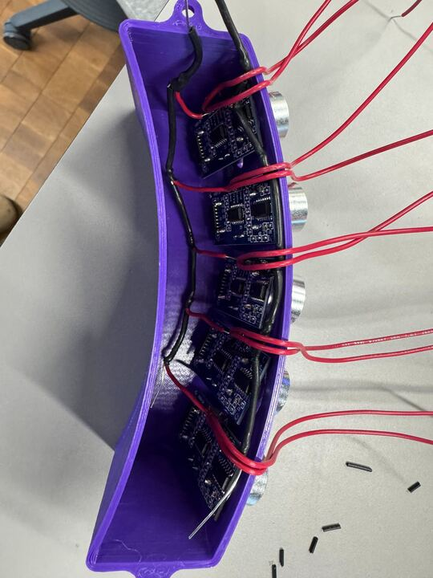
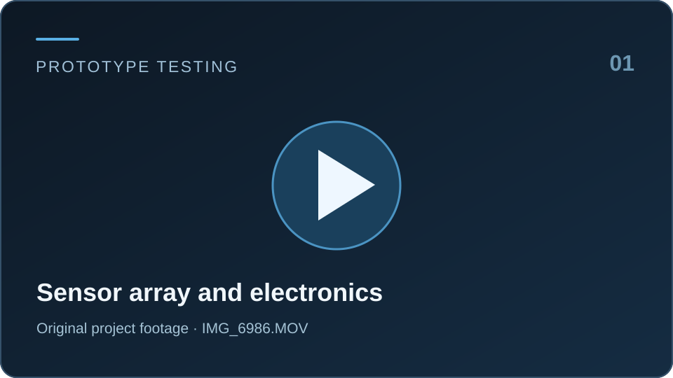
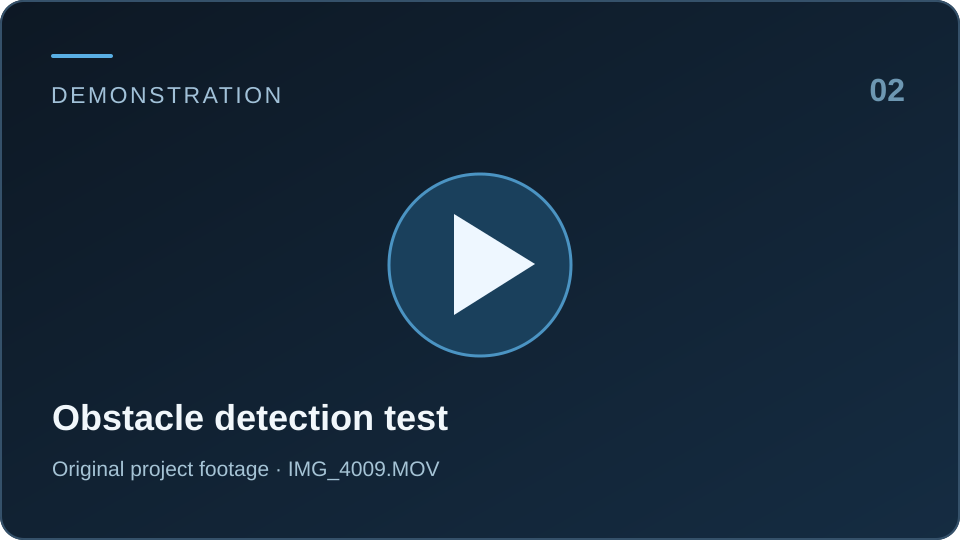
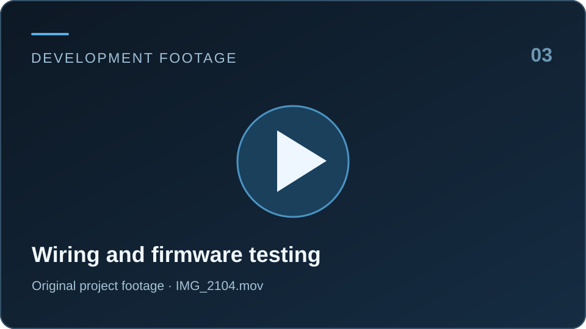

# Multi-Sensor Haptic Headset

**An Arduino-based wearable that translates nearby obstacles into vibration feedback.**

A student engineering project developed with Penn State's **American Society of Mechanical Engineers (ASME)** assistive technology team, January to May 2025. We built and tested a headset prototype with five ultrasonic sensors and five vibration motors to explore how directional, tactile feedback could make obstacles easier to notice without relying on a screen.

### The prototype



*Our physical headset prototype. The image and all the videos below are original project media.*

### Watch the project

Click any card to open its **original video**. All three clips are hosted in this repository.

<table>
<tr>
<td width="33%" valign="top"><a href="./IMG_6986.MOV"></a><br/><strong>01 · Prototype testing</strong><br/>The sensor array, wiring, and Arduino setup.</td>
<td width="33%" valign="top"><a href="./IMG_4009.MOV"></a><br/><strong>02 · Obstacle detection</strong><br/>Testing the system with a physical target.</td>
<td width="33%" valign="top"><a href="./IMG_2104.mov"></a><br/><strong>03 · Development footage</strong><br/>A closer look at the electronics and early tests.</td>
</tr>
</table>

> **Video playback:** GitHub may open a preview or offer the original MOV file for download, depending on your browser. The clips have not been recreated or simulated. [Open all project media in the repository](https://github.com/UnbrokenMango21/AssistiveTechHeadset/tree/main).

## Why we built it

Most navigation tools communicate through a screen or audio. We wanted to explore a different approach: could a wearable tell someone roughly **where** an obstacle is and **how close** it is through vibration alone?

The prototype assigns each ultrasonic sensor to a corresponding vibration motor. When an object enters the useful sensing range, its motor responds. This preserves a simple relationship between the direction of an obstacle and the place where a person feels the feedback.

This is an engineering prototype, **not a tested mobility aid or substitute for established accessibility equipment**.

## How it works

```text
Five HC-SR04 ultrasonic sensors
              ↓
   Echo timing → distance
              ↓
        Arduino Nano
              ↓
 Distance + mode logic (C++)
              ↓
       PWM motor outputs
              ↓
    Five vibration motors
```

| Subsystem | What we used | What it does |
| --- | --- | --- |
| Controller | Arduino Nano, ATmega328P | Reads sensor signals and controls feedback |
| Sensing | 5 × HC-SR04 ultrasonic sensors | Measures nearby object distances |
| Feedback | 5 vibration motors | Provides tactile directional cues |
| Firmware | Arduino C++ | Converts distance readings into motor behavior |
| Debugging | Arduino Serial Monitor, oscilloscope | Helps inspect distance output and signal timing |
| Prototype | Wearable headset, wiring, power supply | Brings sensing and feedback into one physical system |

### Three feedback modes

**Normal:** the motor vibrates more strongly as an obstacle gets closer within the configured sensing range.

**Change Detect:** the system responds to significant changes in measured distance, intended to make movement more noticeable.

**Radar:** vibration pulses become more frequent at closer distances, providing another way to communicate proximity.

The [final demonstration sketch](./Final_Document.ino) implements these three modes and a proximity-based mode switch. Other sketches in the repository explore smoothed PWM transitions, adjacent-sensor burst alerts, and different timing behavior. Those are design iterations, not a claim that every experiment is combined into one validated release.

## What I worked on

I served as the team's **embedded firmware lead** and helped coordinate a group of four engineering students. My work focused on writing C++ control logic, bringing the sensors and motors together, and making the feedback behave consistently enough to demonstrate.

The most interesting problems were practical ones: ultrasonic sensors occasionally gave unexpected readings, closely spaced sensors could interfere with each other, and vibration patterns were difficult to interpret if timing varied. We experimented with the order of sensor readings, thresholds, and PWM response, then checked behavior with serial data and hardware debugging.

This project made me much more interested in embedded systems, particularly the trade-offs between timing, sensing, and the way a person experiences a physical device.

## Firmware and project history

The repository keeps our working sketches and experiments rather than rewriting the history into a single polished result.

| File | Purpose |
| --- | --- |
| [`Final_Document.ino`](./Final_Document.ino) | Three-mode demonstration sketch and two-second proximity mode switching |
| [`ultimate_experimental.ino`](./ultimate_experimental.ino) | Experimental adjacent-sensor burst alerts and pulse timing |
| [`Elliot_Sketch.ino`](./Elliot_Sketch.ino) | PWM smoothing and neighboring-sensor detection experiment |
| [`multi_sensor_first_trial.ino`](./multi_sensor_first_trial.ino) | Early multi-sensor prototype and intensity scaling |
| [`one_sensor_frequency_and_intensity.ino`](./one_sensor_frequency_and_intensity.ino) | Early single-sensor feedback test |
| [`one_sensor_freq_and_vib_new.ino`](./one_sensor_freq_and_vib_new.ino) | Alternate single-sensor test |

### Reproducing the demonstration

1. Connect the sensor and motor hardware **through an electrically appropriate circuit**, with suitable motor drivers, flyback protection, and regulated power. Do not power vibration motors directly from a microcontroller pin.
2. Open [`Final_Document.ino`](./Final_Document.ino) in Arduino IDE and select the appropriate Nano board and serial port.
3. The historical sketch references `arduino_secrets.h`. If your local project does not use that header, remove the unused include before compiling, or provide the original local header.
4. Upload the sketch, open Serial Monitor at **9600 baud**, and inspect the measured distances before testing motor feedback.
5. Test the three modes with controlled obstacles and verify the feedback on the bench before wearing the prototype.

The example pin arrays and sensing thresholds live in the source. Check the wiring against the specific sketch selected because our experiments did not all use identical pin ordering.

## Project presentations

- [ASME Project Showcase presentation](./MULTI_%20SENSOR%20HAPTIC%20HEADSET.pptx) · overview, hardware, modes, and demonstration
- [Software and Code: Initialization](./Software%20and%20Code%20-%20Initialization.pptx) · components, early circuit layout, and firmware development

These are original team presentations from the project.

## What I learned

Working on the headset made it clear that getting an individual sensor to work is only the first step. Once several sensors, motors, power connections, and software decisions share one device, small timing and integration problems become important.

We got a working prototype to demonstrate at the **Penn State ASME Spring Project Showcase**. There is still plenty I would improve in a future iteration, especially the mechanical design, power electronics, timing behavior, and repeatable validation with users.

**Built at Penn State · ASME Assistive Technology Team · Spring 2025**

[Parth Chougule on GitHub](https://github.com/UnbrokenMango21) · [LinkedIn](https://www.linkedin.com/in/parthchougule/)
